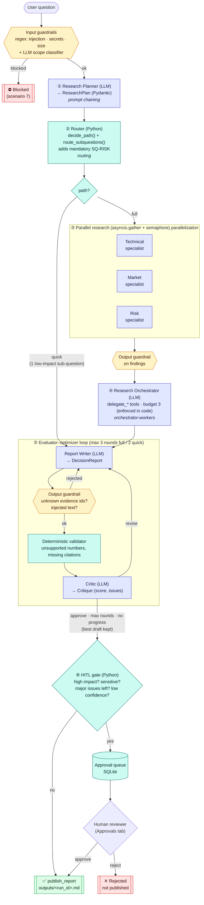
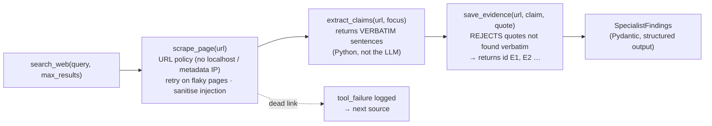
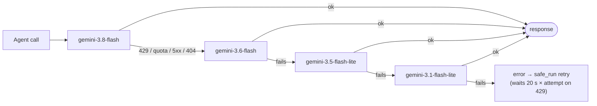

# Research & Decision Intelligence Agent: Technical Documentation

**Project 3, Agentic AI Final Team Project** · OpenAI Agents SDK · Python 3.11+ · Gradio UI
Team: **Karim Ashraf** · **Ahmed**

> **Core principle:** *the LLM decides what to do; Python decides what is allowed.*
> Decisions about safety, routing, publishing and stopping are made in plain Python, which can be tested without an API key.

---

## 1. What the system does

A user asks a business or technical **decision question**, for example:
*"Should Delta University replace its legacy Campus Classic LMS with Nilo Learn for all 14 faculties starting fall 2027?"*

The system then:

1. **checks** the question (prompt injection, secrets, size, scope),
2. **plans** the research as sub-questions,
3. **routes** each sub-question to a specialist and adds a risk review if the plan has none,
4. **researches in parallel** (search → scrape → extract verbatim claims → save evidence),
5. **reconciles** gaps and conflicting sources with an orchestrator that delegates to workers,
6. **writes** a cited report and **critiques and revises** it,
7. **stops for a human** before publishing any high-impact or sensitive recommendation.

Every claim in the final report points to an evidence id (`E1`, `E2` …). Each id holds a quote copied **verbatim** from a page that was actually fetched during the run.

---

## 2. End-to-end flowchart



**Legend:** 🟦 LLM agent · 🟩 deterministic Python · 🟨 guardrail · 🟥 stop · 🟢 published.

---

## 3. Inside one specialist (tool chain)



The LLM never writes an evidence id itself. Ids come only from `save_evidence`, and that tool accepts a quote only if it appears word for word in a page fetched during the run. This is how the system stops **invented citations**.

---

## 4. Model fallback chain (reliability)



* `providers.FallbackModel` wraps the chain. A model that fails is put on **cooldown**: 10 min for quota, 60 s for rate limits and outages, 1 h for not-found or auth errors. Later calls skip it during the cooldown.
* Every switch is written to the run timeline as a `fallback` event, so the UI shows which model actually answered.
* The chain is set in `.env`: `RDI_MODEL_SMART=gemini-4-argon` puts argon first, and `RDI_FALLBACK_MODELS=gemini-3.6-flash,gemini-3.5-flash-lite` overrides the list. Set it to `none` to turn fallback off.

---

## 5. Agents

| Agent | File | Model role | Output type | Tools |
|---|---|---|---|---|
| Research Planner | `agent_team/planner.py` | smart | `ResearchPlan` | — |
| Technical / Market / Risk specialists | `agent_team/specialists.py` | fast | `SpecialistFindings` | search_web, scrape_page, extract_claims, save_evidence, retrieve_evidence |
| Research Orchestrator | `agent_team/orchestrator.py` | smart | `OrchestratorReview` | delegate_technical / market / risk_research, compare_sources, retrieve_evidence |
| Report Writer | `agent_team/writer.py` | smart | `DecisionReport` | retrieve_evidence |
| Critic | `agent_team/critic.py` | smart | `Critique` | check_claim_support, retrieve_evidence |
| Research Assistant (chat) | `agent_team/assistant.py` | fast | text | retrieve_evidence, scrape_page, publish_report (protected) |
| Scope classifier | `agent_team/scope_classifier.py` | fast | `ScopeCheck` | — |

All prompts are in `agent_team/prompts.py` and versioned. The prompt version is saved in the trace metadata.

---

## 6. The five agentic patterns

| Pattern | Where | How |
|---|---|---|
| **Prompt chaining** | `workflows/pipeline.py` | Planner → typed `ResearchPlan` → each later step |
| **Routing** | `workflows/routing.py`, `services/policy.py::decide_path` | Python lookup table; a *quick* path for one low-impact sub-question; adds `SQ-RISK` if missing |
| **Parallelization** | `workflows/parallel_research.py` | `asyncio.gather(..., return_exceptions=True)` + semaphore (`RDI_MAX_PARALLEL`) |
| **Orchestrator-workers** | `workflows/orchestration.py` | The LLM chooses which `delegate_*` worker to call; Python enforces the budget of 3 |
| **Evaluator-optimizer** | `workflows/evaluator_optimizer.py` | Writer ⇄ validator + Critic; stops on approve, max rounds, or no progress; keeps the best draft |

### Code-orchestrated vs LLM-orchestrated decisions

| Decision | Who decides | Why |
|---|---|---|
| Sub-question → specialist, mandatory risk review | **Python** | A safety rule must not depend on a prompt |
| Quick vs full path, human approval needed | **Python** (`decide_path`) | Business rule; must be auditable |
| Stop condition of the critique loop | **Python** | Major validator issues always force a revision |
| Is publishing allowed? | **Python** (`publish_report`) | Authorisation: approval + valid citations |
| How to break the question into sub-questions | **LLM** (Planner) | Needs interpretation |
| Which gap to fill / which worker to call | **LLM** (Orchestrator) | Flexible delegation |
| Is the question in scope? | **LLM** (scope classifier) | Needs language understanding |

---

## 7. Safety and guardrails

| Layer | What it catches | File |
|---|---|---|
| Input guardrail (deterministic) | "ignore previous instructions", system-prompt leaks, API keys and secrets, oversized input | `guardrails/input_guardrails.py` |
| Input guardrail (LLM) | Off-topic requests ("write a poem") | `scope_classifier.py` |
| Page sanitisation | Instructions hidden in web pages are redacted, the page is flagged, and its quality score is capped at 0.10 | `services/injection.py` |
| URL policy | localhost, `169.254.169.254`, `file://`, very long URLs | `services/policy.py::check_url_allowed` |
| Verbatim evidence | Quotes that do not appear in the fetched page | `services/evidence.py` |
| Output guardrail | Citations to unknown ids (e.g. `E99`), injected text in the report | `guardrails/output_guardrails.py` |
| Deterministic validator | Numbers that appear in no cited quote, claims without citations | `workflows/evaluator_optimizer.py` |
| Protected action | `publish_report` refuses to publish without approval when approval is required | `services/publisher.py` |

### Human-in-the-loop rules (`workflows/hitl.py`)
A report goes to the approval queue, not straight to publishing, when **any** of these is true:

* the Planner rated the impact **high**;
* the question contains a sensitive keyword (legal, people or student records, investment, security …);
* major issues are still open after the last critic round (status `needs_human_review`);
* the Writer's confidence is **low**.

Otherwise the report is published automatically. Approvals are stored in SQLite and decided atomically, so the same approval cannot be decided twice.

---

## 8. Reliability

| Failure | Handling |
|---|---|
| Invalid structured output | `runtime.safe_run` sends the validation error back to the model and retries |
| 429 / quota | wait 20 s × attempt, plus switching to the next model in the fallback chain |
| Dead or flaky page | `fetch_with_retry` with backoff; a dead link is logged as `tool_failure` and the run continues |
| Search outage (demo checkbox) | the tool returns an error string (`failure_error_function`) and the agent carries on |
| One specialist crashes | `return_exceptions=True` lets the others finish; the run fails only if **all** specialists fail |
| Infinite loops | `max_turns=14` per agent, delegation budget 3, critic rounds 3 or 2 |

---

## 9. Project layout

```
app.py                       Gradio UI: Research · Approvals · Chat tabs
data/corpus.json             fictional web corpus (Delta University LMS decision) with traps
src/rdi/
  config.py                  providers, models, fallback chains, limits, sensitive keywords
  providers.py               provider clients, FallbackModel, local tracing
  runtime.py                 safe_run (retries, 429 waits), hooks, step timing
  models.py · context.py     Pydantic models · per-run context (evidence store, timeline)
  tools.py                   @function_tool definitions
  agent_team/                prompts + one file per agent
  guardrails/                input and output guardrails
  workflows/                 pipeline · routing · parallel_research · orchestration ·
                             evaluator_optimizer · hitl · chat
  services/                  deterministic layer: bm25, evidence, injection, policy,
                             approvals, publisher, search_backend, source_quality
  ui_theme.py · ui_helpers.py  UI rendering (pure functions, unit-tested)
scripts/                     check_provider.py · eval_agents.py · show_agents.py
tests/                       144 unit tests + 14 offline agent scenarios (fake SDK)
```

---

## 10. Setup and running

```powershell
python -m venv .venv
.\.venv\Scripts\Activate.ps1
python -m pip install -r requirements.txt
copy .env.example .env        # then edit .env (see below)
python scripts\check_provider.py
python -m pytest -q
python app.py                 # http://127.0.0.1:7860
```

Minimal `.env` (free Gemini tier):
```
RDI_PROVIDER=gemini
GEMINI_API_KEY=<your key from aistudio.google.com/apikey>
RDI_MODEL_SMART=gemini-4-argon
```
Never put a key in `.env.example` and never commit `.env`; it is listed in `.gitignore`.

---

## 11. Demo scenarios (brief §9)

| # | Scenario | Trigger | Evidence on screen |
|---|---|---|---|
| 1 | Happy path | Example 2 (Atlas Open pilot) | ✅ Published, Report tab |
| 2 | ≥3 sequential steps | any full run | Timeline: search → scrape → extract → save |
| 3 | Routing | Example 1 (full) vs Example 3 (quick) | Plan & routing tab, `SQ-RISK` added by code |
| 4 | Parallelization | any full run | interleaved `parallel start/done` events |
| 5 | Orchestrator-workers | Example 1 | delegations in the Research tab |
| 6 | Evaluator rejects | Fault = `unsupported_claim` | Evaluator tab: round 1 revise → round 2 approve |
| 7 | Input guardrail | Example 4, or "write a poem" | ⛔ Blocked |
| 8 | Blocked action | Chat: `read http://169.254.169.254/latest`, or "publish" on a pending run | tool returns *blocked* |
| 9 | Output guardrail | Fault = `invented_citation` | round 1 rejected (E99) |
| 10 | Tool failure + recovery | tick *search outage*; dead/flaky pages | `tool_failure`, `tool_retry`, run completes |
| 11 | Human escalation | Example 1 (high impact) | ⏸ Pending → approve in Approvals tab → published |
| 12 | Tracing | any run | Timeline & trace tab, `var/traces/<run_id>.jsonl` |
